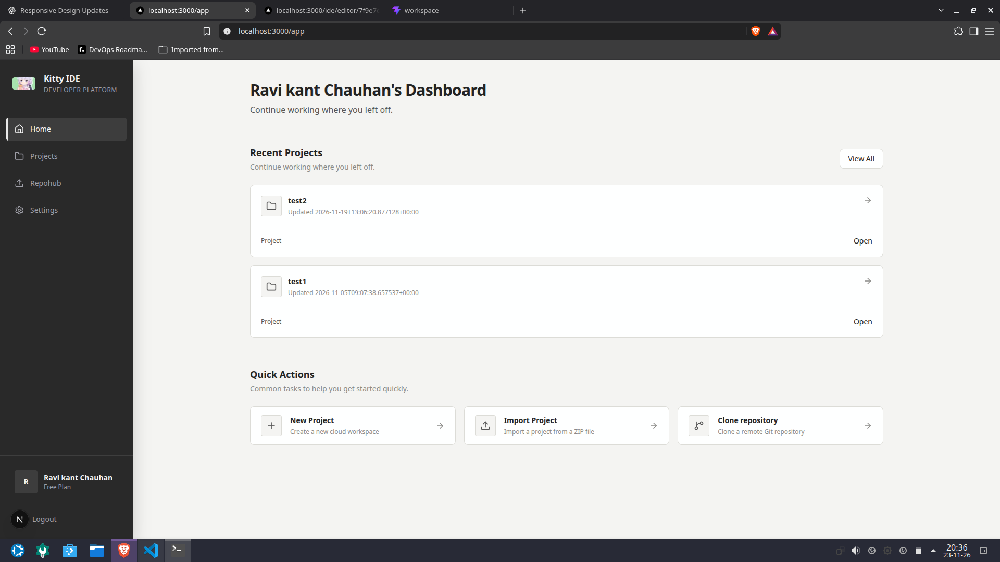
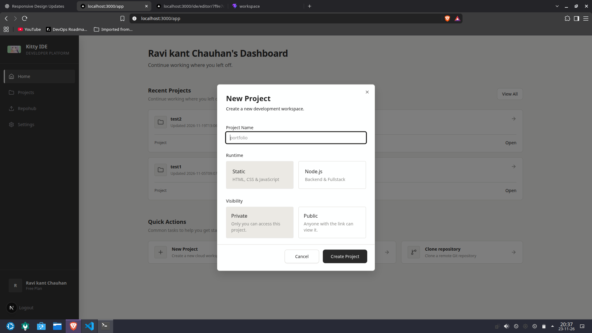
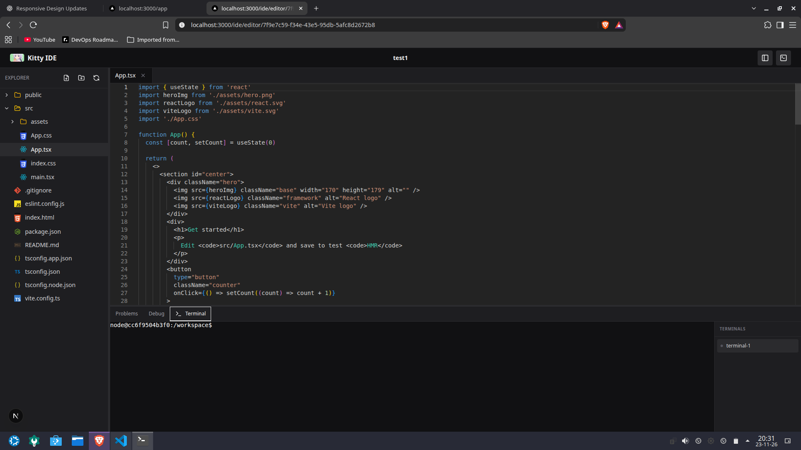
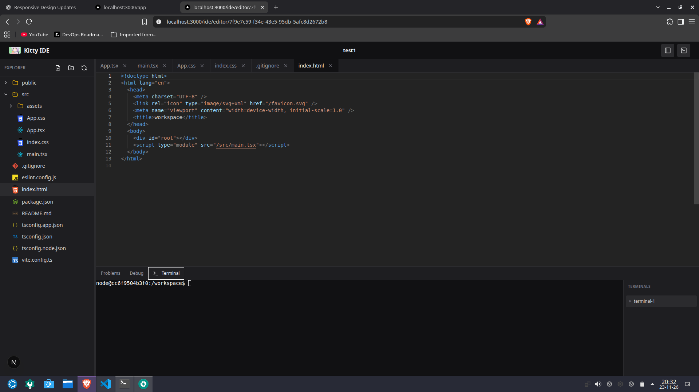
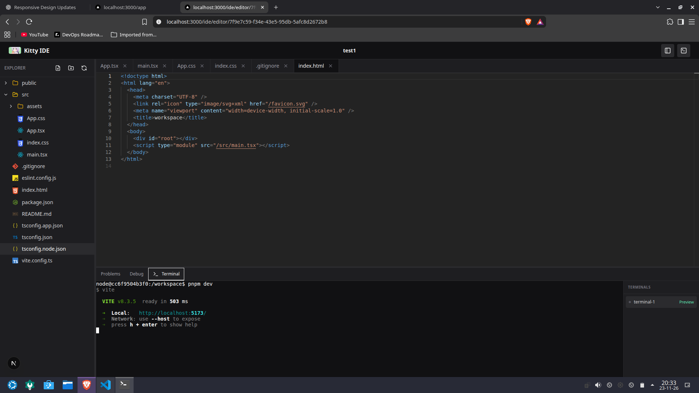
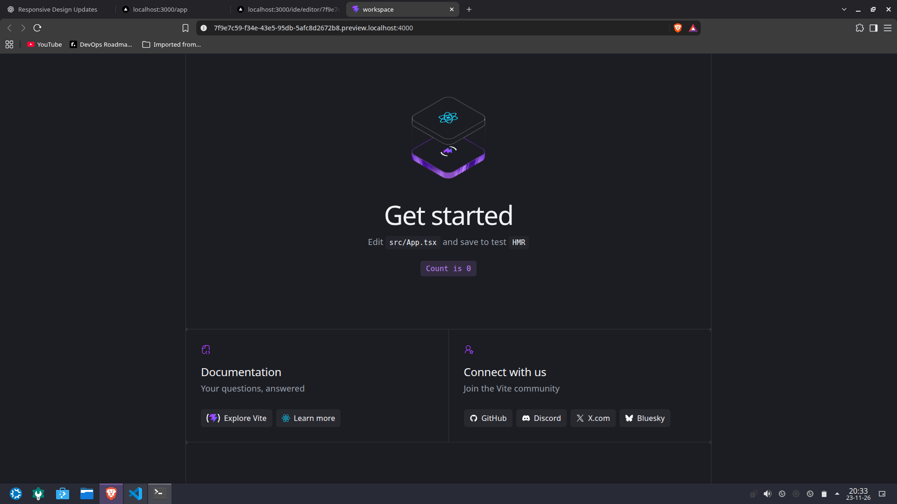
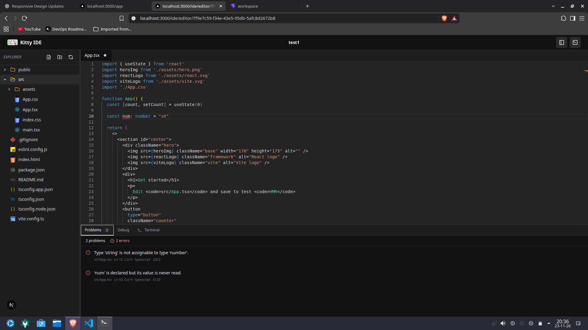
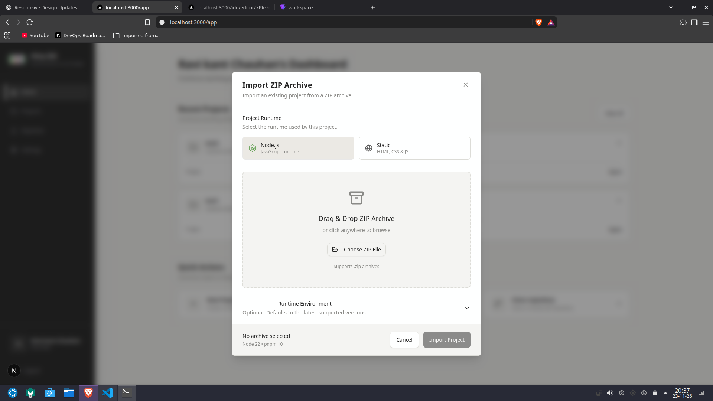
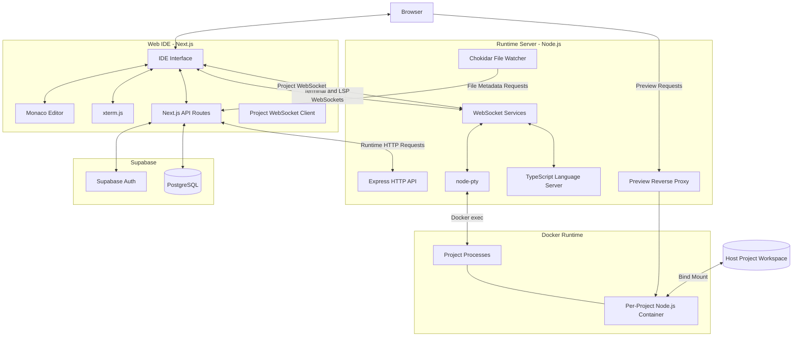

# Kitty IDE

**A browser-based development environment with integrated code editing, project runtimes, terminal access, and live previews.**

Kitty IDE is a full-stack development environment designed to bring project management and development workflows into a single browser-based workspace.

It combines a Next.js frontend with a separate Node.js runtime server. The frontend provides the developer interface, while the runtime server manages project workspaces, Docker-based Node.js environments, terminal processes, filesystem events, preview routing, and language-server communication.

The project explores the engineering challenges involved in building a web-based IDE, particularly around process management, real-time communication, isolated execution environments, and editor integration.

---

## Screenshots

### Dashboard

The dashboard provides a centralized view of projects and common workspace actions.

### Project creation

Projects can be created with either a static or Node.js runtime configuration.

### Code editor

The editor workspace combines Monaco Editor with a file explorer and project navigation.

### Multiple editor tabs

Multiple project files can be opened and managed within the same editor workspace.

### Integrated terminal

The terminal provides shell access to the project's Node.js runtime environment.

### Live preview

Running development servers can be accessed through Kitty IDE's preview routing system.

### Language-server diagnostics

The custom LSP bridge forwards TypeScript diagnostics to the editor's Problems interface.

The following capture uses deliberately introduced TypeScript errors to demonstrate diagnostic reporting.

### ZIP project import

Existing projects can be imported through a ZIP archive workflow, with runtime selection and version configuration.

---

## Features

### Project Management

- Create and manage development projects.
- Choose between static and Node.js project environments.
- Browse projects through a centralized dashboard.
- Import existing projects from ZIP archives.
- Configure supported Node.js and pnpm runtime versions.

### Browser-Based Code Editor

- Monaco Editor integration.
- Hierarchical file and folder explorer.
- Multiple open editor tabs.
- File creation, deletion, reading, and editing.
- Project file saving.
- Language-aware editor configuration.

### Docker-Based Runtime Environments

- Per-project Node.js containers.
- Project workspaces mounted into their corresponding containers.
- Configurable Node.js and pnpm versions.
- Container creation, reuse, and lifecycle management.
- Idle runtime cleanup.

### Integrated Terminal

- Browser terminal powered by xterm.js.
- WebSocket-based terminal communication.
- PTY-backed shell processes using node-pty.
- Terminal processes attached to project containers through Docker.
- Terminal scrollback history and session reuse.

### Live Preview

- Preview support for static projects.
- Node.js development-server preview through a reverse proxy.
- Development-port detection from terminal output.
- Project-specific preview routing.
- Preview availability notifications.

### Filesystem Synchronization

- Workspace monitoring using Chokidar.
- Batched file and directory creation/deletion events.
- Synchronization of workspace structure with project metadata.
- WebSocket notifications for project-tree updates.

### Language Server Integration

Kitty IDE includes a custom Language Server Protocol bridge connecting Monaco Editor to the TypeScript Language Server.

The integration currently supports:

- Language-server process management.
- WebSocket communication between the browser and runtime server.
- LSP message framing over standard input/output.
- Document open, change, and close notifications.
- TypeScript and JavaScript diagnostics.
- Mapping diagnostics to Monaco editor markers.
- TypeScript hover integration.

---

## Architecture

Kitty IDE separates the web application from the infrastructure responsible for project execution.

The frontend manages the developer interface and application data. The runtime server manages project workspaces, containers, terminal processes, filesystem monitoring, preview traffic, and language-server processes.

### Frontend

The frontend is a Next.js application responsible for:

- Authentication and user-facing application flows.
- Project management and workspace navigation.
- Editor state and file tabs.
- Monaco Editor integration.
- Terminal and preview interfaces.
- Communication with the runtime server.

Supabase is used for authentication and application data persistence.

### Runtime Server

The runtime server is a separate Node.js application built with Express and WebSockets.

It handles:

- Project workspace operations.
- Docker container lifecycle management.
- Terminal connections and PTY processes.
- Filesystem monitoring.
- Preview proxying.
- Language-server process management.

Separating runtime execution from the frontend keeps project execution responsibilities outside the browser-facing application.

### Project Workspaces and Containers

Project files are maintained in workspace directories on the runtime server.

For Node.js projects, the workspace is mounted into a Docker container. This allows the container to access the project's files while keeping the runtime environment isolated from the host application process.

Supabase stores project and file metadata, while the runtime server manages the working project files.

### Terminal Communication

The integrated terminal uses xterm.js in the browser and node-pty on the runtime server.

The runtime server starts a PTY-backed shell connected to the project's Docker container. WebSocket messages carry terminal input, output, and resize events between the browser and the runtime server.

### Preview Routing

For Node.js projects, the development server runs inside the project's container.

Kitty IDE detects the development server port from terminal output, resolves the container address, and routes browser preview requests through a reverse proxy.

Static project previews are handled separately through the application's preview mechanism.

### Language Server Communication

The language-server integration follows this communication path:

1. Monaco Editor sends language-server requests through the browser WebSocket.
2. The runtime server receives and forwards JSON-RPC messages.
3. A TypeScript Language Server process communicates over standard input/output.
4. Language-server responses and notifications are forwarded back to the browser.
5. The frontend maps supported language information into Monaco Editor.

The bridge implements LSP message framing using `Content-Length` headers to communicate over the language server's standard input/output streams.

---

## Technology Stack

| Category                | Technologies               |
| ----------------------- | -------------------------- |
| Frontend Framework      | Next.js                    |
| UI Library              | React                      |
| Language                | TypeScript                 |
| Styling                 | Tailwind CSS               |
| State Management        | Zustand                    |
| Code Editor             | Monaco Editor              |
| Terminal Interface      | xterm.js                   |
| Authentication          | Supabase Auth              |
| Database                | Supabase PostgreSQL        |
| Backend                 | Node.js, Express           |
| Real-Time Communication | WebSockets (`ws`)          |
| Terminal Processes      | node-pty                   |
| Runtime Isolation       | Docker, Dockerode          |
| Filesystem Monitoring   | Chokidar                   |
| Language Tooling        | TypeScript Language Server |
| Validation              | Zod                        |
| ZIP Processing          | JSZip                      |
| Testing                 | Vitest                     |

---

## Engineering Challenges

Some of the engineering problems explored while building Kitty IDE include:

- Separating the web application from project execution infrastructure.
- Managing project-specific runtime environments and container lifecycles.
- Connecting browser terminal interfaces to processes running inside Docker containers.
- Synchronizing filesystem changes with project metadata.
- Detecting development-server ports from terminal output.
- Routing preview traffic to the correct project runtime.
- Bridging Monaco Editor with an external language-server process.
- Handling LSP JSON-RPC framing over WebSockets and standard input/output.
- Coordinating communication between HTTP APIs, WebSockets, Docker containers, and filesystem services.

---

## Current Scope and Limitations

Kitty IDE is an actively developed engineering project. Its current implementation focuses on individual project workspaces and their execution environments.

The following capabilities are not currently implemented as complete features:

- Real-time collaborative editing.
- Multi-user shared document synchronization.
- A fully integrated debugging environment.
- Git repository cloning and management.
- A complete IDE-grade language intelligence feature set.

The current language-server integration focuses on TypeScript and JavaScript diagnostics and hover information.

Project visibility metadata exists, but public sharing and access-control workflows should not be considered complete.

The repository documents the current implementation rather than claiming production readiness.

---

## License and Commercial Use

Kitty IDE is source-available under the **PolyForm Noncommercial License 1.0.0**.

The license permits noncommercial use, modification, and distribution, subject to its terms.

**Commercial use is not permitted without explicit written permission from the copyright holder.** This includes, but is not limited to:

- Offering Kitty IDE as a hosted service or SaaS.
- Using the software in a commercial product.
- Selling or commercially distributing the software or derivative versions.

The copyright holder reserves the right to use, modify, distribute, and commercially license the software under separate terms, including through privately maintained versions and modifications.

For the complete terms, see [LICENSE](Web_IDE/LICENSE) and [NOTICE](NOTICE).
